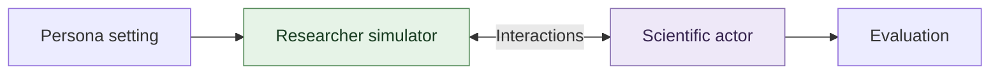

# PersonaScienceBench

Evaluate scientific agents collaborating with persona-conditioned researcher simulators. The simulator receives a persona; the actor solves the scientific task through conversation and tools. Native benchmark evaluators score the result.



Same tasks, five simulator settings. The actor uses tools where applicable; all interactions are saved.

**Start here:** clone this branch → install dependencies/assets → restore frozen tasks → configure your models → run one trial. Setup and restoration make no model calls; evaluation does.

[Evaluation panel](#evaluation-panel) · [Install](#1-requirements-and-installation) · [Restore](#2-restore-the-frozen-tasks) · [Run](#3-run-evaluation) · [Resume](#4-monitor-resume-and-retry) · [Troubleshooting](#troubleshooting)

## Evaluation panel

The frozen panel contains **200 questions × five simulator settings = 1,000 episodes per trial**.

| Benchmark | Questions |
|---|---:|
| ASI-Bench | 40 |
| BixBench | 40 |
| DiscoveryBench | 40 |
| EXP-Bench | 40 |
| SciConvBench | 40 |

Settings: `persona_off`, `candidate_155`, `candidate_001`, `candidate_003`, and `candidate_046`. Question IDs are fixed in [selection.csv](configs/main_run/selection.csv); exact persona prompts are in [configs/main_run/personas](configs/main_run/personas/). Use the same prepared tasks and role settings across all five conditions.

## 1. Requirements and installation

Use **Linux, Git, uv, Python 3.12, and Bubblewrap** (`bwrap`). Setup selects Python 3.12 to match the actor dependency lock; `uv` can download that interpreter if needed. The host must permit Bubblewrap user namespaces and mounts. Install Bubblewrap through your system package manager or set `PERSONASCIENCEBENCH_BWRAP` to an existing executable. API evaluation needs network access, model access and funded credentials. The frozen asset set is roughly 2.8 GiB; allow additional space for downloaded source repositories, dependency environments, scientific outputs and traces. No local GPU is required for API evaluation. macOS and Windows hosts need a Linux execution environment that supports the sandbox.

Clone **the release branch**, not `main` (which contains the research workspace):

```bash
git clone --branch public-release --single-branch \
  https://github.com/MatrAIx-ai/PersonaScienceBench.git
cd PersonaScienceBench
```

The repository currently requires GitHub access. A permission or “repository not found” error is an access issue, not a setup failure. If using GitHub's Download ZIP, first select `public-release`, extract it, and open that directory.

Install [uv](https://docs.astral.sh/uv/getting-started/installation/) and Bubblewrap if absent. On Debian/Ubuntu, a system administrator can install Bubblewrap with `sudo apt-get install bubblewrap`; other distributions use their package manager. Installation of the executable alone does not establish that the host permits its namespaces/mounts.

From the checkout root:

```bash
bash scripts/setup_main.sh
# Create a local key file only if you do not already have one:
[ -f .env ] || cp .env.example .env
# Edit .env with your own provider key(s).
```

Keep this working directory for the remaining commands. The setup script reports each stage and stops on an error; rerun it after fixing the reported issue.

Setup checks sandbox namespace support before large downloads, installs locked controller/actor environments, fetches pinned benchmark sources, downloads selected public assets, and verifies the actor sandbox. It does not launch model episodes. Resolve setup or sandbox failures before running evaluation; do not disable isolation. Upstream asset licenses and access conditions still apply.

The key names are `OPENAI_API_KEY`, `OPENROUTER_API_KEY`, and `XAI_API_KEY`. Populate only the providers you use. Keep `.env` local.

Verify inputs and runtime (both must succeed before evaluation):

```bash
.venv/bin/python scripts/check_main.py
.venv/bin/python -m personasciencebench check-runtime --actor-python .actor-venv
```

## 2. Restore the frozen tasks

Create a separate directory for each independent trial. The preparation bundle is already included in Git; you do not need to request it from a maintainer:

```bash
RUN_DIR="$PWD/runs/model-eval/trial-1"
.venv/bin/python scripts/restore_main_preparation.py --run-dir "$RUN_DIR"
```

The shipped [preparation bundle](configs/main_run/frozen/astra-20260929-v1/README.md) restores the fixed task content and checks downloaded asset hashes without model calls. It does not overwrite an existing preparation directory. Always pass `--require-prepared` to evaluate this frozen panel; otherwise preparation may generate new simulator context. Keep evaluator references outside the actor sandbox.

## 3. Run evaluation

The following template uses one target model for actor and simulator, and an independently specified judge. Replace the model identifiers and efforts with values supported by your account. Effort support varies by model.

```bash
.venv/bin/python scripts/run_main.py \
  --run-dir "$RUN_DIR" --require-prepared --workers 30 \
  --provider openrouter \
  --model YOUR_JUDGE_MODEL --reasoning-effort low \
  --actor-model YOUR_TARGET_MODEL --actor-reasoning-effort medium \
  --researcher-model YOUR_TARGET_MODEL --researcher-reasoning-effort medium
```

**This command makes paid API calls.** `--model` and `--provider` set defaults for **all three roles**; actor/researcher overrides leave the judge on those defaults. `researcher` means the simulator. The template uses OpenRouter model IDs and `OPENROUTER_API_KEY`. To change providers, use `--provider openai` or `--provider xai`; `--actor-provider` and `--researcher-provider` support mixed-role configurations. For the full panel, current EXP accounting supports direct OpenAI IDs `gpt-6-astra` and `gpt-5.6-sol`, and direct xAI ID `grok-4.6`; other direct IDs need verified accounting support before use. OpenRouter uses catalog pricing. Native deterministic evaluators remain deterministic. Keep the judging configuration fixed when comparing models and record all role settings.

Use `scripts/run_main.py` for this release panel. Lower-level package CLIs also expose adapters and historical research workflows; they require explicit configuration (and task cards for EXP) and are not the release quickstart.

All five settings run by default. For an explicitly smaller evaluation, use `--arms persona_off candidate_155` (200 questions per setting). A standalone single setting requires `--standalone-arm --arms candidate_155`. Do not describe a subset as the full panel.

```bash
.venv/bin/python scripts/run_main.py --help
```

Workers control concurrent episodes, not model throughput. Outside SLURM the launcher permits up to 30 workers; under SLURM they must fit `SLURM_CPUS_PER_TASK`. Lower concurrency if provider quotas are tight.

## 4. Monitor, resume and retry

Each run directory records:

| Path | Contents |
|---|---|
| `manifest.json`, `selection.csv`, `configs/` | Run identity, questions and resolved role settings |
| `preparation_receipt.json`, `prepared/` | Frozen task restoration and inputs |
| `progress.json`, `results.json` | Episode status and native evaluation results |
| `episodes/` | Selected and earlier attempts, conversations, submissions, evaluations and logs |
| `code.*.json` | Runtime source hashes |

Repeat the same command with the same run directory to resume. Do not change models or settings inside an existing run directory. A new independent trial uses a new directory and restored preparation.

Use `--retry-infrastructure` for failed executions after resolving their cause; it preserves prior attempts. Inspect failure reasons: format failures and output-cap stops can be model outcomes, not service faults. `--retry-missing` reruns scientific non-submissions and changes the evaluation policy; report it separately rather than treating it as a fresh trial. Do not select attempts by their score.

If `fatal_api.json` is written, resolve the authentication/quota problem and preserve the marker before clearing it to resume. Backoff cannot fix exhausted credit or invalid credentials.

`finished` means execution finished, not that the scientific answer was correct. Inspect native scores, non-submissions, execution errors and grading failures separately. Keep unavailable evaluations distinct from zero-scored non-submissions.

## 5. SLURM (optional)

The submission wrapper requests one node, **30 CPUs and 128 GB RAM** by default. Restore preparation into the same run directory first, then submit:

```bash
export ACCOUNT=your_account PARTITION=your_partition
RUN_DIR="$RUN_DIR" WORKERS=30 bash scripts/submit_main.sh 1 \
  --require-prepared \
  --provider openrouter --model YOUR_JUDGE_MODEL --reasoning-effort low \
  --actor-model YOUR_TARGET_MODEL --actor-reasoning-effort medium \
  --researcher-model YOUR_TARGET_MODEL --researcher-reasoning-effort medium
```

Set `TIME_LIMIT` for your cluster. For sequential jobs, set `DEPENDENCY=afterok:JOB_ID` on the later submission. Each trial needs its own `RUN_DIR`. The launcher validates frozen inputs, configurations and model access before running episodes.

## 6. Inspect and retain results

Native results are stored per episode and consolidated in `results.json`. The raw scale and fields differ by benchmark; retain the native metrics and evaluator version when summarizing results. SciConv disambiguation evaluations include `entity_recovery`, and ordered shared events support conversation analysis.

To render saved logs for local inspection, pass the native output directory for one attempt (replace `TASK_KEY` and `ARM` below), not the campaign root:

```bash
.venv/bin/python scripts/render_run_traces.py "$RUN_DIR/episodes/TASK_KEY/ARM/attempt-1/output"
```

Preserve all attempt histories, role configs, task/selection hashes, preparation receipt, submissions and evaluation inputs. Raw API logs can contain private context; review and sanitize any files before sharing. Generated runs and credentials are excluded by `.gitignore`.

## Offline checks

These checks make no API calls:

```bash
uv sync --locked --python 3.12 --all-extras --inexact
.venv/bin/python scripts/check_main.py
.venv/bin/python -m pytest tests -q
```

`--inexact` retains the separately installed ASI evaluator if setup already installed it. Dependency installation needs network access; the checks themselves make no model calls. For a lightweight input check before installing dependencies, run `python3 scripts/check_main.py`.

See [release validation](docs/VALIDATION.md) for what has been tested and its limits.

Offline checks do not establish model availability, downloaded scientific asset completeness or sandbox readiness on another host. Complete the setup/runtime checks above before a full run.

## Troubleshooting

| Symptom | Action |
|---|---|
| `uv` or `bwrap` not found | Install the missing prerequisite, reopen your shell if PATH changed, and rerun setup. |
| Namespace/mount “Operation not permitted” | Use a host with working Bubblewrap or ask the administrator to enable the required isolation. More API credentials will not fix a sandbox restriction. |
| Download/network failure | Check outbound access to GitHub, Hugging Face and package hosts, then rerun setup. Keep pinned source revisions and asset hashes intact. |
| Missing public assets or hash mismatch during restoration | Finish setup. Preserve any locally modified data and reacquire the pinned files; do not edit the expected checksums. |
| `prepared/` already exists | Resume that trial using the same run command. For a new independent trial, choose a new `RUN_DIR`. |
| Missing preparation with `--require-prepared` | Restore into exactly the same `RUN_DIR` used by the run command. |
| API 401/403, unsupported model/effort, or exhausted credit | Check the configured provider, model access, reasoning support and account balance. Resolve any fatal API marker before resuming. |
| API 429 / repeated rate-limit retries | Reduce `--workers` to fit the provider quota. Thirty workers is a concurrency setting, not a throughput guarantee. |

For an installation report, include the failing command, Python version, host/OS, and relevant error text. Never include `.env` or API keys.

## Layout and license

- `src/`: actor/simulator execution, sandboxing, benchmark adapters and native evaluation.
- `scripts/`: setup, frozen task restoration, run/resume, SLURM submission and trace rendering.
- `configs/`: frozen inputs, personas and runtime configuration.
- `manifests/`: pinned upstream source and asset metadata.
- `tests/`: offline runner and frozen-input checks.

This release contains the evaluation software and frozen panel, not research campaign outputs or manuscript analysis. Repository code is licensed under [MIT](LICENSE); upstream benchmarks and assets retain their own licenses.
