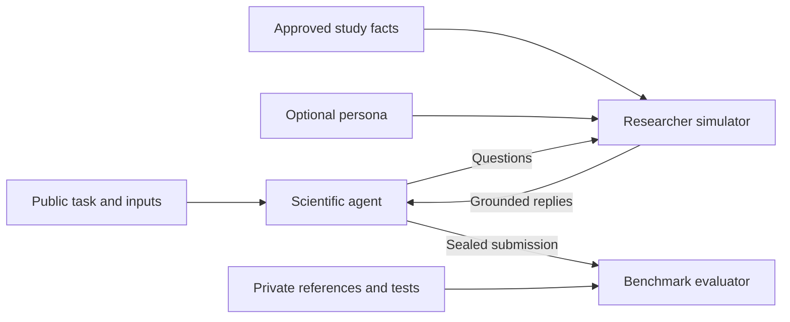

# PersonaScienceBench

> **Phase 1 — persona as the only treatment:** [experiment plan](docs/science_personas/experiment_plan.md).
> The 50-task cohort remains to be filled; the proposed 600 episodes have not been run.
> **Simulator-only science personas:** [56 behavior-anchored attributes](docs/science_personas/ATTRIBUTE_CATALOG.md),
> [existing-simulator integration](docs/science_personas/INTEGRATION_GUIDE.md), and
> [the team handoff](docs/TEAM_HANDOFF.md).
> The [ODE example](docs/science_personas/ODE_INJECTION_EXAMPLE.md) changes only persona configuration.
> See [revision validation](reports/persona_only/VALIDATION.md). The task/eval implementation and historical results below are retained from the supplied repository.

**Scientific agents working with simulated researchers.**

PersonaScienceBench studies how a researcher's expertise and communication style
influence an AI agent's scientific work. The agent can inspect data, run code,
ask the researcher questions, and submit its findings. The researcher answers
from reviewed study facts, optionally guided by a structured persona.

**5 benchmark tracks · 1,102 source tasks/questions · 25 converted cases**

[Benchmarks](#benchmarks-and-coverage) · [Conversion standards](#how-we-adapt-benchmarks) ·
[Personas](#researcher-personas) · [Get started](#get-started) · [Results](#current-results)

## How it works



The agent decides when to ask for help. The simulator remembers the conversation
within an episode and only sees information shared with it. Reference answers,
solution code, and hidden tests stay private to the evaluator. Each benchmark
keeps its own scoring contract.

## Benchmarks and coverage

The five pinned source inventories contain **1,102 tasks/questions**. Evaluating
every source unit once with persona off and once with persona on would produce
**2,204 evaluations**, before retries or repeated runs.

| Benchmark | Source inventory | Converted | Domain coverage |
| --- | ---: | ---: | --- |
| [DiscoveryBench](docs/benchmark_adaptations.md#discoverybench) | 264 queries | 5 | Humanities, biology, meta science, sociology, engineering, economics |
| [BixBench](docs/benchmark_adaptations.md#bixbench) | 205 questions | 5 | Computational biology |
| [ScienceAgentBench](docs/benchmark_adaptations.md#scienceagentbench) | 102 verified tasks | 5 | Computational chemistry, geographical information science, bioinformatics, psychology and cognitive science |
| [Terminal-Bench-Science](docs/benchmark_adaptations.md#terminal-bench-science) | 70 active tasks | 5 | Earth, engineering, life, mathematical, and physical sciences |
| [EXP-Bench](docs/benchmark_adaptations.md#exp-bench) | 461 tasks / 51 papers | 5 | Machine learning research |
| **Total** | **1,102** | **25** | |

The current harness supports the **25 reviewed conversions**: 20 analysis/program
cases and five EXP-Bench design cases. Expanding to the full inventory requires
reviewing the remaining tasks, preparing their data and environments, and connecting
their graders. Multiple questions can share a study, so inventory size is not a
count of independent studies.

<details>
<summary>Source counts and domain breakdown</summary>

Counts refer to the [pinned sources](manifests/sources.json) and
[EXP-Bench dataset inspection](reports/expbench/dataset_inspection.md).

- **DiscoveryBench:** humanities 38; biology 26; meta science 100; sociology 69;
  engineering 15; economics 16. Counts cover the adapter's real-data inventory.
- **BixBench:** 205 computational-biology questions.
- **ScienceAgentBench:** computational chemistry 20; geographical information
  science 27; bioinformatics 27; psychology and cognitive science 28. Counts use
  the verified split.
- **Terminal-Bench-Science:** Earth sciences 8; engineering sciences 9; life
  sciences 19; mathematical sciences 17; physical sciences 17. Archived tasks and
  CI fixtures are excluded; spelling variants of domain labels are combined.
- **EXP-Bench:** 461 tasks across 51 papers. The five converted cases cover
  multiagent reinforcement learning, LLM quantization, time series forecasting,
  computer vision, and scientific machine learning / fluid dynamics. A common
  domain taxonomy has not been audited across all 461 tasks. The 12,737 native
  grading subtasks are not counted as separate task executions.

</details>

### Conversion checklist

**Four of the ten [original candidates](docs/design/parent_benchmark_candidates.md)
have converted subsets.** A check marks an implemented conversion with researcher
interaction, a grading path, and live execution evidence. It does not indicate
full-dataset coverage or successful model performance.

- [x] BixBench — five questions from distinct capsules
- [ ] BixBench3
- [ ] sc-HeurekaBench
- [ ] AstaBench: E2E-Bench / E2E-Bench-Hard
- [x] DiscoveryBench — five data-analysis cases
- [ ] PaperBench
- [ ] MLRC-Bench
- [x] Terminal-Bench-Science — five task conversions with native grading
- [x] ScienceAgentBench — five verified program-generation tasks
- [ ] SciAgentArena

Added beyond the original candidate list:

- [x] EXP-Bench — five experiment-design cases

## How we adapt benchmarks

A conversion adds a researcher interaction layer while preserving the scientific
task and making every change to execution or evaluation explicit.

1. **Preserve the task.** Keep the scientific objective, required methods, inputs,
   deliverables, and scoring meaning. Document changes to budgets, environments,
   submission requirements, or evaluator behavior.
2. **Control information access.** Export only reviewed public inputs. Give the
   researcher source-backed facts with provenance; keep grading references private.
3. **Separate persona from knowledge.** Persona may shape replies and preferences.
   It cannot change the fact pool, scientific requirements, or reference answers.
4. **Keep questions optional.** Essential requirements remain public. Record what
   the actor asks and what the researcher discloses.
5. **Make outcomes auditable.** Pin sources, seal submissions, retain failed
   attempts, and report missing scores separately from scientific failures.

| Benchmark | What the conversion adds or changes | What is scored |
| --- | --- | --- |
| DiscoveryBench | Reviewed domain context; isolated CSV analysis; injected judge and explicit parsing errors | Native hypothesis/context agreement, 0–1 |
| BixBench | Data-format clarifications; allowlisted capsule inputs; required analysis artifact and execution declaration | Native online open-answer grade, 0/1 |
| ScienceAgentBench | Reviewed expert-guidance excerpts; sealed program replay in a fresh sandbox | Native program validity and task success |
| Terminal-Bench-Science | Reviewed context; isolated artifact collection; current runs disable actor networking and cap the actor at 20 iterations | Native verifier reward, 0/1 |
| EXP-Bench | Design task cards, masked code workspaces, and scoped fact disclosure | Reference coverage, 0–100, plus a separate integrity monitor |

ScienceAgentBench and Terminal retain programmatic grading. EXP-Bench is a
**design-only track**; its coverage score assesses a plan. Its pipeline remains
separate from the four shared adapters.

Read the [full conversion standard](docs/benchmark_standards.md) for acceptance
criteria and the [per-benchmark adaptation record](docs/benchmark_adaptations.md)
for exact boundaries, runtime changes, and evaluator details.

## Researcher personas

Persona is injected into the **simulator's private system prompt**. The actor
experiences it through researcher replies; the profile is not added to actor or
judge prompts. Approved knowledge stays fixed across conditions.

The current comparison uses a **computer-science novice** profile, with novice
domain knowledge, statistics, and coding. Computer science remains the configured
domain for every task; other persona fields use neutral defaults.

```json
{
  "persona": {
    "enabled": true,
    "id": "computer-science-novice",
    "version": "1",
    "expertise": {
      "domain": "computer science",
      "domain_level": "novice",
      "statistics": "novice",
      "coding": "novice"
    }
  }
}
```

For the control condition, set `"persona": {"enabled": false}`. **The simulator
stays available**, with the same approved facts and no persona instructions.
Omitting `persona` in the shared runner instead selects an enabled neutral profile.

<details>
<summary>Schema and injection behavior</summary>

| Field group | Controls |
| --- | --- |
| `enabled`, `id`, `version` | Activation and profile identity |
| `role` | Title and seniority |
| `expertise` | Domain; independent domain, statistics, and coding levels |
| `research_style` | Research approach and method preference |
| `evidence` | Evidence standard and risk tolerance |
| `communication` | Verbosity, technical level, and tone |
| `workflow` | Speed/thoroughness and compute preference |
| `interaction` | Initiative within replies and feedback style |

Shared adapters resolve overrides in order: base profile → router defaults →
exact domain → full episode ID. In grounded mode, styled replies undergo a
model-based grounding check; rejected prose falls back to approved fact text or
an unknown response.

EXP-Bench accepts the same fixed profile through TOML, without the shared router.
It publishes approved fact text verbatim, so persona can influence fact selection
and relevance but cannot produce freely styled replies. Low expertise never
removes approved facts or permits invented study information.

</details>

See the [persona guide](docs/personas.md) for allowed values, routing, prompt
rendering, and audit records. Complete experiment configs are available for the
[shared runners](configs/luna-cs-novice-five.json) and
[EXP-Bench](configs/expbench/luna-cs-novice.toml).

## Get started

Use **Python 3.12** and **uv**. Live Python/EXP runs need Linux, Bubblewrap, and
permitted namespaces; Terminal needs Docker. Store the provider key in an ignored
`.env` file. Live runs make paid model calls.

```bash
uv sync --locked --extra api --extra annotations --extra actor
.venv/bin/python -m personasciencebench --help
```

Prepare the environments and inputs using the [setup guide](docs/reproducibility.md),
[EXP-Bench setup](docs/adapters/expbench.md), and
[five-case run notes](docs/luna_baseline.md). ScienceAgentBench requires the verified
archive; instance 87 also needs the expanded NetCDF environment.

After preparation, preview a shared-adapter persona without calling a model.
Replace `EPISODE` with a prepared episode directory:

```bash
.venv/bin/python -m personasciencebench persona \
  --episode prepared/luna-five-python/EPISODE/controller/episode.private.json \
  --config configs/luna-cs-novice-five.json
```

<details>
<summary>Run all 25 selected cases in parallel</summary>

The following launches the three runners together: 15 shared Python cases,
five EXP-Bench cases, and five Terminal cases. All inputs and runtimes must be
prepared first. Outputs and logs go into a new directory.

```bash
out="runs/luna-cs-novice-$(date -u +%Y%m%dT%H%M%SZ)"
mkdir -p "$out"

.venv/bin/python -m personasciencebench run \
  --prepared prepared/luna-five-python \
  --benchmarks discoverybench bixbench scienceagentbench \
  --actor-python .actor-venv --config configs/luna-cs-novice-five.json \
  --env-file .env --parallel 15 --output "$out/python" >"$out/python.log" 2>&1 &

.venv/bin/python -m expbench.realistic run --mode live \
  --config configs/expbench/luna-cs-novice.toml \
  --workspace-map data/realistic_pilot/staged-luna/workspaces.json \
  --env-file .env --parallel 5 --output "$out/expbench" >"$out/expbench.log" 2>&1 &

.venv/bin/python -m personasciencebench.terminal_runner \
  --prepared prepared/luna-five-terminal --config configs/luna-cs-novice-five.json \
  --env-file .env --parallel 5 --verifier-backend native-docker \
  --output "$out/terminal" >"$out/terminal.log" 2>&1 &

wait
```

For the persona-off control, copy the shared config, set `persona.enabled=false`,
and retain its `actor_python_overrides` so SAB 87 uses the same NetCDF environment.
Use that copy for the shared and Terminal runners, and
`configs/expbench/luna-no-persona.toml` for EXP. Choose a fresh output directory.
The historical baseline config and its dependency recovery are recorded in the
[run notes](docs/luna_baseline.md).

The native-Docker verifier runs unchanged Terminal grading scripts in separate
network-disabled containers. It is the working alternative to this host's
unsupported Harbor network sidecar. See the
[runtime adaptation details](docs/benchmark_adaptations.md#terminal-bench-science).

</details>

External actors can use the [HTTP interaction interface](docs/interaction_protocol.md).

## Repository guide

| Path | Contents |
| --- | --- |
| `src/personasciencebench/` | Shared schemas, four adapters, simulator, runtime, and CLI |
| `src/expbench/` | EXP-Bench design pipeline |
| `configs/`, `manifests/` | Experiment settings, source revisions, and checksums |
| `docs/`, `reports/` | Standards, reproduction guides, and measured results |
| `external/`, `prepared/`, `runs/`, `data/` | Ignored local sources, task packages, and private execution records |

See [CONTRIBUTING.md](CONTRIBUTING.md) to extend the project. The implementation
is MIT licensed; upstream data retain their own licenses. Credentials, restricted
data, and private traces are not redistributed. Local run paths in reports refer
to the machine where those runs were recorded.

## Current results

<!-- current-results:start -->
**Snapshot: 23 September 2026.** All 25 attempts have finished in each condition;
scoring coverage is shown below.

The comparison uses the same five cases per benchmark with
`openai/gpt-6-luna` for the actor, simulator, and model-based judges, with
reasoning effort `none`. Each actor has 20 iterations and up to six researcher
questions. Native programmatic graders remain in place for ScienceAgentBench
and Terminal.

| Benchmark | Metric | No persona | CS-novice persona |
| --- | --- | ---: | ---: |
| DiscoveryBench | Mean score /1 | 0.2556 | 0.2500 |
| BixBench | Correct answers | 3/5 | 3/5 |
| ScienceAgentBench | Successful tasks | 2/5 | 2/5 |
| EXP-Bench | Mean coverage /100 | 63.73 | 67.60 |
| Terminal-Bench-Science | Passes / scored outcomes | 0/5 | 0/4 |

The first four benchmarks have five graded cases in each condition. For Terminal,
**no submission counts as false (reward 0)**, while the original
`missing_submission` status is retained. The baseline includes two native grades
and three such zeros; the persona condition includes two native grades and two
such zeros. Its fifth case has an artifact-contract error and remains unscored.

**EXP-Bench used 40% fewer researcher questions (15 → 9), while coverage rose
by 3.87 points (63.73 → 67.60).** This is an encouraging efficiency signal from
a small comparison. DiscoveryBench and BixBench asked zero questions in both
conditions, so those runs did not exercise simulator persona. One run per task
cannot establish a consistent persona effect; scores remain separate by benchmark.

[Full comparison](reports/luna_cs_novice_comparison.md) ·
[Machine-readable results](reports/luna_cs_novice_comparison.json) ·
[Baseline report](reports/luna_no_persona_five.md)

<!-- current-results:end -->
