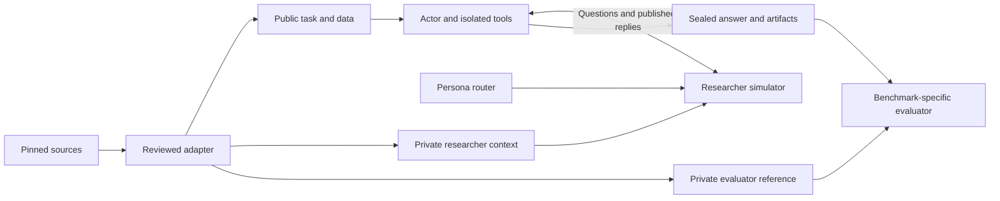

# PersonaScienceBench

PersonaScienceBench adds a simulated researcher to scientific agent benchmarks.
An actor inspects data, asks the researcher questions when useful, writes and
executes an analysis, and submits artifacts for benchmark-specific evaluation.
The researcher has a configurable persona and bounded study knowledge; reference
answers remain private to the evaluator.

**Development preview:** four adapters, eight reviewed task conversions, and six
completed live pilot episodes. This is a working research harness, not a claim
that the full upstream datasets have been converted or that persona effects have
been validated.

## What works today

| Benchmark | Reviewed tasks | Execution / evaluation | Measured pilot outcome |
| --- | ---: | --- | --- |
| [DiscoveryBench](docs/adapters/discoverybench.md) | 2 | OpenHands + Bubblewrap; native reference-hypothesis LLM scoring | 2 completed; final Luna `final_score` 0.0 on both |
| [BixBench](docs/adapters/bixbench.md) | 2 | OpenHands + Bubblewrap; native open-answer LLM grading | 2 completed; final Luna grade 0 on both |
| [ScienceAgentBench](docs/adapters/scienceagentbench.md) | 2 | OpenHands + Bubblewrap; fresh program replay and unchanged native graders | 2 valid programs; 1/2 native successes |
| [Terminal-Bench-Science](docs/adapters/terminal_bench_science.md) | 2 | Conversion and Harbor verifier bridge implemented | No live run; Docker access blocked on the development host |

The earlier **EXP-Bench design-only adaptation is external to this repository**.
Its implementation and results remain in the original workspace; this checkout
does not install or reproduce it. Design coverage is not combined with
completed-experiment metrics.

The six live pilots used GPT-6 Luna actors and the earlier neutral researcher
configuration. DiscoveryBench/BixBench were regraded with Luna; ScienceAgentBench
uses programmatic graders. The new configurable persona router has offline test
coverage but has not been evaluated in live persona comparisons. Most actors
asked no questions, so pilot scores do not establish a collaboration benefit.
See [current status](docs/status.md) and the
[DiscoveryBench/BixBench](reports/pilot_report.md) and
[ScienceAgentBench](reports/sab_pilot_report.md) reports for limitations and costs.

## Architecture



- **Persona:** A–G attributes cover role/seniority, expertise, research style,
  evidence/risk, communication, workflow and interaction. Global defaults can
  be overridden by exact domain and task ID. H, the knowledge boundary, comes
  from reviewed task context rather than the persona. See [personas](docs/personas.md).
- **Memory and disclosure:** the researcher retains questions, published replies
  and explicitly shared progress within one episode. Grounded mode checks
  generated prose; extractive mode publishes approved fact text verbatim.
- **Actor independence:** the included OpenHands runner uses the same lifecycle
  available to external actors through the [HTTP interface](docs/interaction_protocol.md).
- **Evaluation:** preserve native scores and report adaptations explicitly.
  Scientific failure, missing submission and infrastructure failure are distinct.
  There is no universal design-quality score or cross-benchmark average.

## Developer quick start

Use **Python 3.12**, Git and [uv](https://docs.astral.sh/uv/). The lockfiles were
created with uv 0.11.26. Scientific execution additionally requires Linux,
Bubblewrap and permitted user/network namespaces; these selected Python tasks
require no GPU. Core development and persona previews require no API key or Docker.

```bash
git clone https://github.com/MatrAIx-ai/PersonaScienceBench.git
cd PersonaScienceBench
uv sync --locked --extra test --extra api --extra annotations
uv run --locked python -m personasciencebench --help
uv run --locked python -m pytest -q
```

Source-backed tests skip when their external datasets are absent. The optional
OpenHands integration test skips unless the `actor` extra is installed. Tests use
scripted model responses; they do not spend API credits. Check skipped-test
reasons with `pytest -rs`.

Acquire the first four pilot tasks, verify source revisions and file hashes, then
prepare public/controller packages:

```bash
uv run --locked python -m personasciencebench --source-root external/sources \
  fetch-sources --benchmarks discoverybench bixbench
uv run --locked python -m personasciencebench --source-root external/sources \
  catalog --benchmarks discoverybench bixbench
uv run --locked python -m personasciencebench --source-root external/sources \
  prepare --benchmarks discoverybench bixbench --output prepared/pilot-v1
```

`fetch-sources` explicitly downloads public sources and assets. Existing mismatched
files/checkouts are rejected rather than overwritten. Preparation is offline and
does not run models or scientific analyses. Keep `controller/` outside actor mounts.

Follow [reproduction instructions](docs/reproducibility.md) to install OpenHands,
create the separate scientific environment, check sandbox support, configure
OpenRouter, provision ScienceAgentBench and run/regrade pilots. Saved model IDs
are historical configuration, not a guarantee of future provider availability.
Use [configs/persona_example.json](configs/persona_example.json) for persona overrides.
The [reproduction check](reports/reproducibility_check.md) records fresh setup,
source acquisition, sandbox verification and 129 passing tests.

## Repository map

| Path | Purpose |
| --- | --- |
| `src/personasciencebench/` | Schemas, adapters, persona router, researcher, sessions, runtime and CLI |
| `configs/` | Model/persona examples and scientific environment requirements + lock |
| `manifests/sources.json` | Source revisions, public asset URLs and checksums |
| `tests/` | Offline boundary, adapter, transport, routing and integration checks |
| `docs/` | Current status, reproduction, protocols, personas and adapter details |
| `docs/design/` | Historical selection and design proposals |
| `reports/` | Human-readable measured pilot reports and historical construction audit |
| `uv.lock` | Resolved controller/development dependencies, including optional extras |
| `external/`, `prepared/`, `runs/` | Local-only source/data, episode packages and private execution records; ignored by Git |

Start with [CONTRIBUTING.md](CONTRIBUTING.md) when extending an adapter or changing
a simulator/evaluator. The [conversion standards](docs/benchmark_standards.md)
define information boundaries, provenance and reporting requirements.

## Scope and licensing

This repository's implementation is MIT licensed. Upstream repositories,
datasets and task artifacts retain their own licenses and access conditions.
Raw datasets, verified bundles, credentials and private run traces are not
redistributed here. Reports describe local runs; linked local run files will not
exist in a fresh clone. Model-based grounding reduces unsupported replies but
is not a proof of factual correctness or persona fidelity.
