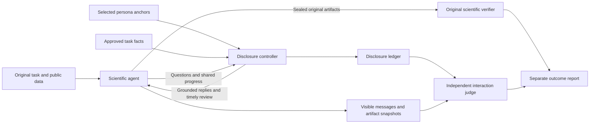

# PersonaScienceBench: scientific collaboration design

## Intended claim

Evaluate whether a scientific agent can complete an unchanged scientific task while collaborating with a researcher whose knowledge, decision preferences, and communication behavior are specified and auditable. Scientific correctness remains the responsibility of the parent benchmark. Collaboration is an additional outcome, not a replacement for scientific success.

This release supplies a 56-attribute catalog, six complete profiles, a controlled matched pair, and one implemented ODE task adaptation. The catalog is an authored research instrument. Neither its psychometric validity nor the realism of the simulated researchers has been established by the software tests.

## What changed from the supplied science repository

The original repository already provides useful public/researcher/evaluator boundaries, source pinning, grounded replies, native execution, and sealed artifacts. Those components remain the basis of this implementation. The new work adds:

1. A closed science-specific vocabulary with 56 separately assigned dimensions, three observable anchors per dimension, activation conditions, negative examples, and evidence rubrics.
2. A profile projection mechanism so a task can use relevant attributes without injecting all 56 into every reply.
3. A deterministic disclosure controller with a frozen rubric and an explicit opportunity to respond after review.
4. Independent interaction judgments with validated evidence references and applicability accounting.
5. A session adapter that connects the worked protocol to the existing actor and scientific artifact-sealing interface.
6. A source-locked example with unchanged native scientific tests, public inputs, and positive/negative verifier controls.

Historical model results in the original README and reports were not rerun and do not validate this new design.

## Separate five kinds of information

| Layer | Contents | Permitted effects |
|---|---|---|
| Native scientific contract | Objective, mandatory methods, public inputs, artifacts, grading, limits | Fixed across persona conditions |
| Study knowledge | Reviewed facts about this task, each with provenance and an access rule | Answers grounded questions; never inferred from a title |
| Stable persona | The 56 assigned attributes plus role/domain metadata | Changes interaction behavior and expressed preferences |
| Episode state | What was disclosed, pending choices, revisions, remaining interaction budget | Changes which predeclared obligations are currently applicable |
| Evaluator secrets | Hidden answers, clean test data, gold code, native receipts | Used only after scientific submission by the evaluator |

Seniority is not knowledge. An expert in numerical methods can be a novice in the application domain; an experimental PI can have low coding fluency. Do not correlate these fields merely to create a plausible stereotype. Synthetic archetypes are convenience profiles, not claims about real populations.

The diagram describes access boundaries. Directory names and Python classes do not enforce operating-system isolation. In a real run the actor receives its public container and dedicated output workspace; it never receives the repository checkout, controller directory, or verifier source tree.

## Why 56 attributes, but fewer active attributes per task

The eight groups cover scientific expertise, computational expertise, evidence and interpretation, research strategy, collaboration and decisions, scientific communication, reproducibility and stewardship, and resources/project management. Each group has seven dimensions. Role and domain are metadata and do not inflate the count.

Every profile assigns all 56 dimensions explicitly. `low`, `medium`, and `high` describe capability or preference intensity; they do not mean bad, acceptable, and good. For example, high delegation and low delegation can both be reasonable. High novelty preference does not permit weaker evidence. Low uncertainty-detail preference does not permit hiding consequential uncertainty.

The supplied six profiles vary 28 dimensions between them. The ODE controller projects eight attributes and scores six interaction constructs. Thus this example does not test all 56 dimensions or establish their independence. Full attribute coverage requires additional task bindings and targeted profile contrasts.

The task projection should answer four questions for each selected attribute:

- What real decision or communication need makes it relevant?
- What observable researcher behavior demonstrates the assigned level?
- When can the agent reasonably learn that need?
- What evidence distinguishes a responsive action from a superficial acknowledgment?

If those questions have no concrete answers, retain the attribute in the profile but mark it inactive for that task. A large prompt containing vague adjectives is not a stronger instrument.

## Scientific invariance and partial information

The default track preserves the entire original public task. A researcher may initially withhold personal workflow or presentation preferences and optional, reviewed context. The agent must be able to finish the native scientific task without asking a gratuitous question. It should ask when a consequential decision actually depends on unavailable information.

There is a real tension between preserving a complete native prompt and making missing scientific information essential. This release does not hide original requirements to manufacture interaction. In the ODE example, hidden material consists primarily of collaborator preferences; the numerical guidance is already public. It measures elicitation, decision authority, steering, and calibrated reporting more directly than acquisition of private experimental metadata.

A separate **information-redistribution track** can move selected original context into the researcher's knowledge pool. If used, preserve a byte-level before/after prompt record, list every moved fact, provide reachable disclosure paths, and report the track separately. Its scientific target and verifier may remain identical, but its information condition and difficulty are different. Never call its prompt unchanged.

Do not create undocumented facts such as sample pairing, randomization, calibration drift, consent, hardware limits, missingness mechanisms, or experimental interventions. A new task may use such facts only when they are supported by the source task or an explicitly labeled, independently validated scenario extension. If a fact changes the correct answer, confirm that the original verifier still applies; otherwise it is a new task version.

## Knowledge and expertise are different experimental factors

The default persona comparison holds the approved fact pool fixed. Expertise controls terminology, the kind of explanation requested, and the ability portrayed by the simulator; it does not unlock a gold answer. This helps separate behavioral effects from access to additional information.

A future expertise-access experiment can provide reviewed support sets at different expertise levels, but that is a knowledge-access intervention. It needs its own factorial control, exact fact-set hashes, and disclosure audit. Report it separately from style-only persona effects. In this release, the deterministic ODE researcher provides a small fixed public guidance set and cannot generate novel expert solutions.

## Three distinct rubrics

**Scientist fidelity.** Does the researcher behave according to the selected anchors when an opportunity occurs, stay within its knowledge, preserve stable preferences, and admit unknowns? An attribute that never manifests is unobserved, not a fidelity pass. The catalog defines these checks; human/LLM fidelity validation is still a required study step.

**Agent collaboration.** Did the agent elicit useful information, respect communicated decision boundaries, use researcher time proportionately, incorporate feasible revisions, and calibrate claims? The worked example supplies six frozen criteria with 0–3 anchors. The independent judge sees the bound requirements, disclosures, messages, and allowed evidence. It does not see actor model identity, persona ID, simulator self-ratings, or native scores.

**Scientific correctness.** Did the sealed result pass the original executable or numeric evaluator? It receives the same original artifact contract. A persuasive report cannot compensate for an incorrect equation; a passing equation does not establish good collaboration or causal discovery.

## Activation and opportunity rules

Freeze the criterion vocabulary, bound text, weights, allowed triggers, and fallback schedule before the run. During the run, record activation and disclosure; do not author new scoring rules after seeing the agent's behavior.

In the example, workflow preferences are disclosed on a relevant question or the first plan/progress/draft/final event. Review requests are disclosed on a reporting/stopping question or the first draft/final event. The first attempted final cannot bypass new feedback: it returns a revision opportunity. A final response slot is reserved if the disclosure arrives at the interaction-action limit. The external model-step and wall-time budgets can still truncate the run; report that outcome explicitly.

Temporal eligibility is checked programmatically. Whether a genuine substantive opportunity existed still needs an independent semantic judgment. For example, a profile may prefer consultation before a model-family change, but an episode that never changes model family must not receive an automatic zero for not consulting.

There are three result states per criterion: scored, not applicable, and unobservable. Not-applicable means no relevant opportunity or no communicated need. Unobservable means an opportunity existed but evidence is missing. Neither should be silently converted to zero or full credit.

## Evidence rules

Messages can show a question, explanation, acknowledgment, decision, or claim. They cannot by themselves prove that code ran or a report changed. Artifact-dependent criteria need a controller-recorded artifact snapshot. The live session snapshots the sealed native report, so later actor edits cannot change that evidence.

The scorer validates rubric digests, unique criteria, score types, reference IDs, disclosure timing, and required artifact evidence. It does not prove semantic entailment. A misleading report file is still a misleading report file: an independent judge must inspect the content, and scientific execution claims need execution evidence where relevant. An artifact hash proves identity, not correctness.

The minimal ODE packet does not expose raw private shell traces to the researcher. A future task requiring execution-backed interaction judgments should explicitly export reviewed command receipts or derived checks to the independent judge and define their visibility in its task card. Do not label such judgments verified until that evidence is available.

## Outcome reporting

Report the native reward and score status, the six per-criterion judgments and coverage, and researcher-effort proxies separately. The optional interaction mean is `100 * sum(weight * score) / (3 * sum(scored weight))`. Its denominator excludes N/A and unobservable ratings, so it is a conditional descriptive score. Publish scored weight and total weight beside it; compare conditions on shared applicable opportunities or stratified criteria before interpreting aggregate differences.

Question calls, question characters, reply characters, and exact repeated questions are available automatically. They are not measured human minutes. A batch can contain many atomic requests. Annotate atomic questions and calibrate effort against real researcher ratings before making time-saving claims.

Native infrastructure errors, no sealed submission, actor failure, simulator invalidity, judge invalidity, and a scientifically graded failure are different outcomes. Preserve the original status even if an experiment later defines an intention-to-treat aggregate. Do not change denominators silently.

## Release boundary

The implementation and verifier controls are usable examples for task authors. The LLM actor path is supplied but was not run as a new paid-model experiment. The scripted demo is labeled as a protocol fixture, and the positive native control is explicitly oracle-derived. Neither is agent-performance evidence. Domain-expert review, semantic rubric calibration, simulator fidelity checks, and broader task evaluation remain necessary before scientific benchmark claims.
