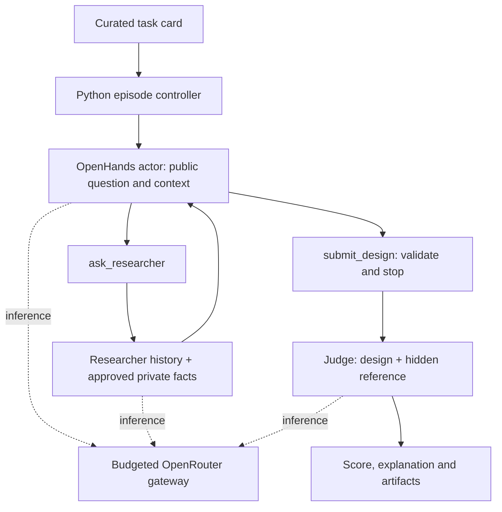

# Implementation notes

Historical implementation notes, migrated from the original EXP-Bench workspace.
Use [the current EXP-Bench guide](../adapters/expbench.md) for setup and paths.

## Roles and data flow

OpenHands owns actor history, planning, action parsing, tool execution, and its
iteration limit. `GatewayLLM` changes only its inference boundary, converting
SDK messages and tool schemas to OpenRouter Chat Completions requests. This
lets actor, researcher and judge share one cost guard and logging implementation.
The adapter uses the pinned SDK's response conversion helper and is tested
against that exact package; upgrading requires rerunning integration tests.

The researcher is a separate stateful client, not a second OpenHands agent.
Each question appends a user message to its history; the returned structured
answer is appended as an assistant message. The actor receives only the answer
as a tool observation. Provider reasoning metadata is retained when returned.
No conversation state is shared across episodes, and no automatic history
summarization is enabled in this bounded pilot.

## Information boundaries

The controller reads `data/design_pilot/tasks.jsonl`, which contains all three
roles' sections. It passes an explicit allowlist of fields to each role. The
researcher never receives `reference_design` or original `expected_outcome`.
The actor has no arbitrary file-read, network, terminal or Python tool and cannot
inspect the controller's filesystem or API credentials. `read_context` resolves
only exact names in the public document dictionary. Its OpenHands workspace is
a fresh empty temporary directory. Automatic skills, persistent user memory,
MCP servers and default tools are disabled.

This is an interface boundary for this restricted actor, not a sandbox suitable
for adding arbitrary shell execution. Adding terminal or repository tools would
require a separately isolated container with only public material mounted.

Each pilot question has been made neutral about expected outcomes. Researcher
facts are selected background, scope, existing configurations and reporting
conventions from the annotations; they are not a copy of the reference variable
inventory or the full experiment method. Missing quantities remain unspecified.
The design itself must supply comparisons, controls, procedure and analysis.

## Evaluation and termination

The design schema requires an objective, three variable lists, procedure,
analysis plan and explicit assumptions. Schema validation checks format, not
scientific validity. Only `submit_design` creates the final artifact; conversational
prose alone is not a successful submission. The submitted design is immutable.
The judge is invoked only after a valid submission and has no tool access.
It receives the public task, the approved researcher facts, and the reference
inventory. Giving it the approved facts prevents avoidable ambiguity about the
source configuration (for example, whether a specific RevIN configuration is
the baseline instance normalization). This clarification is version 2 of the
adapted judge prompt; it does not change the three scored variable groups.
The `regrade` command applies the current judge consistently to saved designs
without repeating actor or researcher calls and preserves the original outputs.

The adapted judge follows the original variable-matching rubric. Scores remain
subjective, reference-dependent LLM assessments and should not be interpreted as
the probability an experiment will work. Mock grades are clearly marked and are
excluded from summary scores. API errors, missing submissions, truncated replies,
invalid structured responses and budget failures are recorded separately.

Live researcher answers with valid evidence IDs can still contain unsupported
interpretations. Manually inspect the pilot for invention, inconsistent answers,
and excessive disclosure before expanding. Hold the researcher and judge settings
fixed when comparing actor models. Group future train/dev/test splits by source
paper to avoid near-duplicate tasks crossing splits.

## Sources

- [EXP-Bench paper](https://arxiv.org/abs/2505.24785)
- Original judge prompt: `data/exp_bench/raw/upstream/prompts/eval_judge_prompt.txt`
- Original snapshots and hashes: `data/exp_bench/manifest.json`
- [OpenHands custom tools](https://docs.openhands.dev/sdk/guides/custom-tools)
- [OpenHands SDK package](https://pypi.org/project/openhands-sdk/1.49.3/)
- [OpenRouter structured outputs](https://openrouter.ai/docs/guides/features/structured-outputs)
- [OpenRouter reasoning tokens](https://openrouter.ai/docs/guides/best-practices/reasoning-tokens)

Task derivatives preserve the upstream CC BY 4.0 attribution in the root README
and raw dataset files. Selection and edits are recorded in each card's provenance
and review notes and in `scripts/expbench/build_design_pilot.py`.
