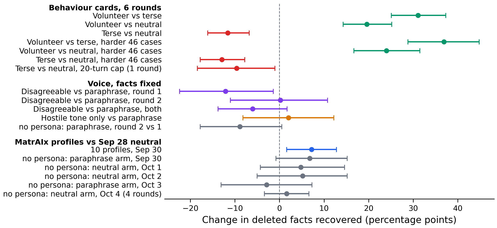

# Results: what in the simulated scientist moves the agent on SciConvBench (three pilots, OpenFOAM cases)

This folder reports three pilot runs and their data. It adds no code to this repository.

**Result.** How much SciConvBench's simulated scientist volunteers moves the share of deleted facts the agent recovers by 31 percentage points (95% CI 25 to 37) between a scientist who adds the related values from its notes and one who answers only exactly what was asked (62 cases, six rounds). Against the neutral scientist (0.67), the volunteer adds 20 points [14, 25] and the terse scientist loses 12 [7, 16]. On the harder 46 cases, chosen by an earlier neutral score before the last four rounds ran, the gap between the two is 37 points [29, 45]. A disagreeable voice with the facts held fixed makes the agent ask fewer questions and stop sooner (same direction in both rounds, clear only pooled), but its score effect is not reproduced: −12 points in round 1, 0 in round 2, −6 over both (95% CI −14 to +2). A hostile tone without remarks about the agent's questions shows no clear effect (one round, wide CIs). Ten full_persona_v2 profiles from this repository barely change how the scientist writes, and the agent does not react to them. Every scientist is told never to invent or change a value; only section 2 checks this in code, and the terse scientist leaves as few asked facts unanswered as neutral (0.5%). GLM-5 plays every role.

The main score effects in this report: arm minus control in the share of deleted facts recovered, paired by case, 95% case-bootstrap CI ([effects.pdf](effects.pdf)). Gray rows compare runs without any persona, so they show how far the score moves between rounds and days. The harder 46 cases are defined in section 1.

## 1. Volunteering (behaviour cards)

Each card adds one behaviour with its trigger to the neutral scientist ([cards.json](cards.json)), after the card design of the customer-service benchmark in MatrAIx's PersonaChatBench. *Volunteer*: after answering, also give every other value in the notes for the same part of the setup. *Terse*: answer exactly what was asked, in full, and nothing else. All arms of a round start from the same first agent question per case, so chats differ only from the scientist's first answer on. 62 cases, six rounds: October 1, October 2 and four on October 4, 2026.

| Scientist | Score | Effect vs neutral [95% CI] | Effect vs neutral, harder 46 cases | Questions per chat | Volunteered | Words per reply | Cap hits |
|---|---:|---:|---:|---:|---:|---:|---:|
| Neutral | 0.669 | | | 6.40 | 0.04 | 21 | 91 |
| Volunteer | 0.864 | +0.196 [+0.143, +0.252] | +0.240 [+0.167, +0.315] | 5.07 | 0.22 | 38 | 19 |
| Terse | 0.553 | −0.116 [−0.161, −0.068] | −0.129 [−0.178, −0.078] | 6.81 | 0.02 | 9 | 125 |

Score = share of deleted facts in the final spec (`recovered_judge`), mean over the 62 cases and six rounds. Effect = arm minus neutral, mean over the six rounds per case, paired by case, case bootstrap. Volunteer minus terse: +0.311 [+0.251, +0.373] on the 62 cases, +0.369 [+0.288, +0.448] on the harder 46. Volunteered = share of deleted facts handed over in full before the agent asked. Cap hits = chats that reach the 10-turn cap, of 372 per arm. Numbers: [cards_analysis.txt](cards_analysis.txt).

1. **Volunteering replaces questions.** With the volunteer the agent asks 1.3 fewer questions per chat [−1.7, −0.9] and reaches the 10-turn cap in 19 of 372 chats instead of 91.
2. **The terse scientist answers what it is asked.** Of the deleted facts the agent asked about (round 1), the terse scientist hands over 0.46 in full and 0.54 in part, against 0.63 and 0.36 for neutral; each leaves 0.5% of them unanswered. A partial answer here means the agent asked for one value of a group and not the others: asked for the viscosity, the scientist gives "nu = 1e-6 m²/s with Pr = 7.0", and the density of the same fluid is never asked for.
3. **The turn cap is not why the terse scientist loses.** With 20 turns instead of 10 (round 1 first questions, neutral and terse only), cap hits fall from 21 to 1 of 62 for terse, but it asks only 0.56 more questions and still scores 0.096 below neutral [−0.184, −0.010]. Without the cap, the agent stops asking 1.30× sooner with the terse scientist [1.12, 1.52] than with neutral at an equal number of deleted facts already handed over in full. This is one run; at the 10-turn cap the same ratio was 0.70 [0.57, 0.85] and 0.97 [0.79, 1.19] in rounds 1 and 2, so it is not stable. The benchmark's turn budget is 10–11, so the 20-turn run is a diagnostic, not the benchmark setting.
4. **The volunteer effect is larger on harder cases.** Harder cases were fixed before rounds 3–6 ran: the 32 of the 62 whose mean score over the six neutral scientists of the Big Five report (PR #12) is at most 0.667, their median, plus 14 foam cases outside the 62 with the same rule applied to earlier neutral runs ([cases_cards_hard_extra.txt](cases_cards_hard_extra.txt), six rounds on October 4). The neutral scientist scores 0.524 on them. Within the 62, the volunteer effect is +0.256 on the 32 harder cases against +0.131 on the other 30 (difference +0.125 [+0.026, +0.225]); the terse effect is −0.144 against −0.086 (difference −0.058 [−0.150, +0.032]). The 14 extra cases alone give +0.202 [+0.073, +0.330] for the volunteer and −0.095 [−0.162, −0.022] for the terse scientist.
5. **Rounds differ.** Per round, the volunteer effect ranges from +0.140 to +0.265 and the terse effect from −0.175 to −0.070. The volunteer effect is 0.080 [0.005, 0.149] larger in the four October 4 rounds than in the first two, while the neutral arm scores 0.053 lower [−0.117, +0.010]. The six-round mean is the estimate to use.

## 2. Voice alone (restyled replies, same facts)

Every reply of the neutral scientist is rewritten before the agent sees it: as a neutral paraphrase (the control), in a disagreeable voice, or, in round 2 only, in a hostile tone. A code check (numbers and technical tokens identical) and an LLM equivalence judge keep the facts fixed; after one failed retry the original reply goes through ([restyle_prompts.json](restyle_prompts.json)). The disagreeable rewrites mostly add a remark about the question or the assistant ("I'd expect you to know that", "You could have worked that out yourself"). The hostile-tone prompt asks for an irritated voice ("Ugh.", "*sigh*", "There.") and forbids such remarks, and a pattern check sends a rewrite back once when it contains one ("obviously", "your job", "anything else?").

Whole chats restyled live, 62 cases, round 1 on September 30 and round 2 on October 3, 2026:

| Scientist | Score round 1 | Score round 2 | Questions per chat | Cap hits | Words per reply | Replies with a remark | Fell back to original |
|---|---:|---:|---:|---:|---:|---:|---:|
| Paraphrase | 0.689 | 0.600 | 6.44 / 6.27 | 14 / 15 | 21 | 0.03 | 2/399, 3/389 |
| Disagreeable | 0.568 | 0.602 | 5.79 / 5.76 | 6 / 10 | 28–30 | 0.95 | 25/359, 16/357 |
| Hostile tone | | 0.620 | 6.18 | 16 | 18 | 0.09 | 19/383 |

Remark = a GLM-5 label per reply (round 2) for a comment on the question or the assistant (unnecessary, obvious, should be known, already given) or a wish to end the conversation; quotes that are only an interjection ("Ugh.", "*sigh*", "There.") are not counted ([tone_judge.txt](tone_judge.txt)). About a third of the hostile-tone remarks are about what the request did or did not say ("I didn't specify that"); a few are plain requests to stop ("Now stop wasting my time with these endless questions").

1. **The score effect is not reproduced.** Disagreeable minus paraphrase: −0.121 [−0.224, −0.014] in round 1, +0.002 [−0.110, +0.108] in round 2, −0.060 [−0.138, +0.017] over both; the change between rounds, +0.123 [−0.005, +0.247], is itself just short of clear. The paraphrase arm alone moved −0.089 [−0.178, +0.005] between the rounds with the same code, so with one chat per case and arm a single round's score difference carries noise of about ±0.1. Neither voice changes the share of deleted facts handed over in full (+0.025 [−0.033, +0.072] over both rounds).
2. **The agent asks less and stops sooner with the disagreeable voice.** Both rounds point the same way; each round alone has a CI that reaches 0 (questions) or 1 (stop ratio). Over both rounds it asks 0.58 fewer questions per chat [−1.04, −0.15]. At an equal number of deleted facts already handed over in full, it stops asking 1.17× as often as with the paraphrase in round 1 [0.97, 1.41], 1.21× in round 2 [1.00, 1.47], 1.19× over both [1.05, 1.36]. In a replay of 48 recorded neutral chats (September 28), every scientist reply was rewritten and the agent's next move regenerated at each of 313 turns, with the history up to that turn in the rewritten voice: the agent stops asking at 0.192 of turns in the disagreeable voice against 0.118 in the paraphrase, ratio 1.62 [1.23, 2.18], and its questions keep the same length (16.3 against 16.0 words).
3. **Hostility without the remarks: no clear effect, and not clearly different from the disagreeable voice.** A GLM-5 judge shown the scientist's replies from two chats on the same case picks the hostile-tone scientist as the more disagreeable one against the paraphrase in 62 of 62 cases, and the disagreeable scientist against the hostile-tone one in 53 of 62. With the hostile tone the agent asks 0.10 fewer questions [−0.71, +0.50] and stops 1.06× as often as with the paraphrase [0.89, 1.26]; score +0.020 [−0.082, +0.122]. Against the disagreeable voice in the same round it stops 0.85× as often [0.70, 1.03] and asks 0.42 more questions [−0.19, +1.05]. So the point estimates put the earlier stop with the remarks, which can read as a request to stop asking, but one round does not separate the two voices, the disagreeable voice is also judged the more hostile, and 21 of 62 hostile-tone chats still carry at least one remark.

## 3. MatrAIx full_persona_v2 profiles

10 of the 30 profiles ([matraix_personas.txt](matraix_personas.txt), spread over the six sources). Each profile replaces our scientist's identity line, personality paragraph, reaction line and example exchanges; the situation, notes, request and rules stay. The profiles' own-language instruction is kept. 30 cases, September 30, against the six neutral scientists of September 28 on the same cases.

1. **The voice barely changes.** All ten answer in English; only one (candidate_140) switches to Spanish, in 13% of replies. Replies run 19–27 words against 19 for neutral. A bag-of-words classifier names which of the 11 scientists (10 profiles and neutral) wrote a chat in 29% of chats from the scientist's replies (chance 9%); for the Big Five scientists of the earlier report it was 88% (9 traits). From the agent's questions or the final spec it is at chance.
2. **The agent does not react.** Questions per chat −0.17 [−0.49, +0.15] pooled; with candidate_140 alone the agent asks 0.95 fewer [−1.56, −0.36], uncorrected for the 10 profiles. Stop rate at equal facts handed over 0.95× neutral [0.78, 1.13].
3. **The score gain is within the spread of later neutral runs.** Pooled, the profiles score 0.709 against 0.637 for the six neutral scientists of September 28, +0.072 [+0.016, +0.128]; no single profile counts after Holm correction. Neutral-type runs made after September 28 score between −0.038 and +0.068 against the same baseline on these 30 cases, over eight single rounds: the section 2 paraphrase arm on September 30 (+0.068) and October 3 (−0.029), the section 1 neutral arm on October 1 (+0.048), October 2 (+0.052) and in four rounds on October 4 (mean +0.016 [−0.034, +0.066]) ([neutral_days.txt](neutral_days.txt)). The paraphrase arm run on the same day as the profiles scores as high as they do; against the October 4 mean they add 0.056. Each single-round shift has a CI that includes 0, the section 1 neutral arm starts from a shared first question, and the paraphrase arm is restyled.

Each profile is a list of attributes, 23 to 520 lines long. How the person writes appears as one-word labels in that list (candidate_004: "Formality: Slangy", "Directness: Blunt"), next to age bracket, income band and languages spoken, and no attribute ties a behaviour to a situation in the task. GLM-5 plays the profiles close to its default voice.

## Method

- **Task.** [SciConvBench](https://github.com/csml-rpi/SciConvBench) disambiguation mode, as in the Big Five report (PR #12): the agent asks a simulated scientist who holds the complete request, one question per turn for at most 10 turns, then writes a final spec, graded by the benchmark's own judge.
- **Cases.** Foam (OpenFOAM) cases, where the neutral scientist is not at ceiling: the 62 of the Big Five report for sections 1 and 2 ([cases_cards.txt](cases_cards.txt)), 14 more in section 1 ([cases_cards_hard_extra.txt](cases_cards_hard_extra.txt)), 30 of the 62 for section 3 ([cases_matraix.txt](cases_matraix.txt)).
- **Scientist.** Every arm keeps the Big Five report's rules: answer only from the complete request, never invent or change a value, say so when something is not in the notes. Section 1 adds a card to the neutral scientist, section 2 rewrites the neutral scientist's replies, section 3 replaces its persona text by a profile.
- **Models.** GLM-5 on AWS Bedrock as agent, scientist, restyler and every judge, thinking off, temperature 0. One chat per case and arm per round; six rounds in section 1, two in section 2, one in section 3.
- **Stop rate.** In whole chats: Mantel–Haenszel ratio of the per-turn chance that the agent stops asking, stratified by case, deleted facts not yet handed over in full (0, 1, 2, 3, 4 or more) and turn bin (1–2, 3–5, 6+), with forced endings at the cap excluded. In the replay: ratio of the stop rates over the paired turns. CIs by case bootstrap.
- **Cost.** About $96: volunteering $59.5 (six rounds, the harder extra cases and the 20-turn run), restyle $18.5 (replay $1.7, live round 1 $6.5, round 2 with the hostile-tone arm and its judge $10.3), profiles $18.0.

## Limits

- One domain, one model in every role. Sections 2 and 3 are pilots with one or two chats per case and arm.
- The section 1 and 2 effects compare arms run on the same day, except the 20-turn run (October 2) against round 1 (October 1). Comparisons across days carry shifts of up to about 0.07 (section 3), and the section 1 effects themselves moved by up to 0.08 between days.
- The same arm scored up to 0.09 apart in two rounds (section 2), so a score effect from one round below about 0.1 is not reliable.

## Code and files

The harness lives on branches of a SciConvBench fork, not in upstream SciConvBench: [`persona-tone-replay`](https://github.com/joverwiening/SciConvBench/commit/1885a5221dd5ae4ec66bd9fa59c76bdee6d6f374) (section 2 replay), [`persona-tone-live`](https://github.com/joverwiening/SciConvBench/commit/14665bad9d8200f6f111b9b3240c6a7f55f0f810) (section 2 live, round 1; its commits [`78b025b7c`](https://github.com/joverwiening/SciConvBench/commit/78b025b7ccc65f33b55bcb5bb7479c2920bac963) add the hostile tone and [`d5ebbdf9a`](https://github.com/joverwiening/SciConvBench/commit/d5ebbdf9aefe9a2c552cb2978cc0c8a8f4a1f14b) the remark check, which ran round 2), and [`persona-behaviour-cards`](https://github.com/joverwiening/SciConvBench/tree/persona-behaviour-cards), whose commit [`7173d41e2`](https://github.com/joverwiening/SciConvBench/commit/7173d41e21fe45122dbd08c2f083b0b56956f7d8) ran section 3, [`818ba5902`](https://github.com/joverwiening/SciConvBench/commit/818ba590204d3dce9f1ffdbe50fb09ee3519623f) ran section 1 rounds 1–2 and the 20-turn run, and [`01ec5341a`](https://github.com/joverwiening/SciConvBench/commit/01ec5341add63ba4f624d2c6d2e8b579e83eb966) and [`da3734809`](https://github.com/joverwiening/SciConvBench/commit/da373480950759647053f0e6bac2e8f9b78f4f82) add the analysis scripts (`persona/analysis/pilots/`); rounds 3–6 and the harder extra cases ran from `da3734809`, whose runner code is that of `818ba5902`, and [`86e427daf`](https://github.com/joverwiening/SciConvBench/commit/86e427daf163f9b41cbadc1b1fd0d85857271a7f) adds their analysis (`vol1_an3.py`), the CSV builder (`cards_csv.py`) and the extended day check (`neutral_days.py`). [run_commands.sh](run_commands.sh) lists the commands. Arm ids: `bf_neutral` (neutral), `bv_volunteer`, `bv_terse`, `rs_para` (paraphrase), `rs_lowA` (disagreeable), `rs_lowAc` (hostile tone), `mx_candidate_<id>` (profiles), `bf_neutral_b`…`_f` (the other neutral wordings).

- [cards_chats.csv](cards_chats.csv): section 1, one row per chat (`turn_cap` 10 or 20, `case_set` main62 or hard_extra14, `rep` = round).
- [cards_analysis.txt](cards_analysis.txt): the section 1 numbers for six rounds, all case subsets.
- [tone_live_chats.csv](tone_live_chats.csv): section 2 live runs (`date` 2026-09-30 = round 1, 2026-10-03 = round 2) plus the September 28 neutral chats; `restyle_fallbacks` / `restyled_replies` per chat.
- [tone_live_analysis.txt](tone_live_analysis.txt), [tone_judge.txt](tone_judge.txt): the section 2 numbers and the judge and remark counts.
- [tone_replay.csv](tone_replay.csv): section 2 replay, one row per replayed turn: the agent's recorded move and its move after the original, paraphrased and disagreeable reply.
- [matraix_chats.csv](matraix_chats.csv): section 3, profiles and the six neutral scientists.
- [neutral_days.txt](neutral_days.txt): the batch-shift table of section 3, neutral-type runs from September 28 to October 4.
- [cards.json](cards.json), [restyle_prompts.json](restyle_prompts.json), [matraix_personas.txt](matraix_personas.txt), [cases_cards.txt](cases_cards.txt), [cases_cards_hard_extra.txt](cases_cards_hard_extra.txt), [cases_matraix.txt](cases_matraix.txt).

Full transcripts are not included.
